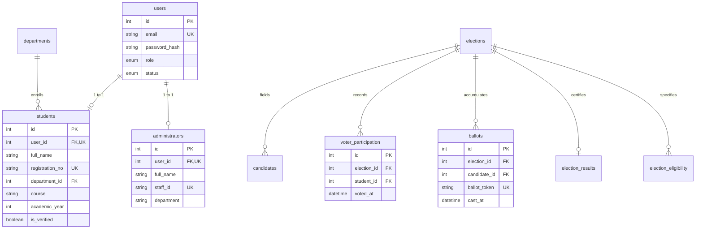

# 🗳️ College Voting System

> A complete, production-ready, full-stack web-based college election platform built with **PHP 8.x**, **MySQL 8.x**, **Bootstrap 5.3**, and **PDO**. Designed as an academic capstone and portfolio project demonstrating ACID transaction-safe voting logic, decoupled ballot privacy, role-based access control, interactive animations, and a comprehensive automated test suite.

**GitHub Repository:** [https://github.com/Thanigaivelk-official/College-Voting-System](https://github.com/Thanigaivelk-official/College-Voting-System)

---

## 📋 Table of Contents

- [Key Highlights & Architectural Features](#key-highlights--architectural-features)
- [Technology Stack](#technology-stack)
- [System Architecture & Ballot Privacy Model](#system-architecture--ballot-privacy-model)
- [Interactive UI & Hero Animation](#interactive-ui--hero-animation)
- [Full Setup & Installation Process](#full-setup--installation-process)
- [Administrative & Voter Credentials](#administrative--voter-credentials)
- [Spreadsheet & Excel Exports](#spreadsheet--excel-exports)
- [Project Directory Structure](#project-directory-structure)
- [Security & Threat Defense Matrix](#security--threat-defense-matrix)
- [Database Schema Design](#database-schema-design)
- [Automated Testing Suite (75/75 Passed)](#automated-testing-suite-7575-passed)
- [GitHub Deployment & Synchronization](#github-deployment--synchronization)
- [Step-by-Step Live Demonstration Checklist](#step-by-step-live-demonstration-checklist)
- [Resume Description](#resume-description)
- [Technical Interview Q&A Guide](#technical-interview-qa-guide)
- [License](#license)

---

## ✨ Key Highlights & Architectural Features

### 🎓 Student / Voter Portal (`public/`)
- **Self-Registration & Whitelist Validation:** Students can register using their institutional email and registration number; verified automatically against pre-approved whitelist tables.
- **5-Layer Voter Eligibility Verification:**
  1. Student account status check (`active` vs `suspended`).
  2. Institutional verification check (`is_verified = 1`).
  3. Election status check (election must be currently `open`).
  4. Demographic eligibility matching (department and academic year filtering).
  5. Duplicate submission check (verifies voter has not already cast a ballot).
- **Decoupled Secret Ballot Submission:** Generates an irreversible SHA-256 confirmation hash; voter participation records are decoupled from anonymous ballot counts.
- **Voter History & Manifestos:** Students can browse candidate profiles, agendas, and manifestos before casting votes.
- **Live Published Election Results:** Interactive turnout graphs, candidate vote share percentages, and winner declarations.

### 🏛️ Election Commission Administrator Portal (`admin/`)
- **Executive Commission Dashboard:** Real-time metrics showing total registrations, active polls, ballots cast, and audit logs.
- **Election Lifecycle Management:** Schedule, activate (`scheduled` → `open`), close (`open` → `closed`), and publish results with automated time-based status synchronization.
- **Candidate Nomination & Photo Upload:** Add candidates with verified photo uploads, manifestos, and election assignments (includes MIME validation and strict size limits).
- **Voter Whitelist Management & CSV Import:** Bulk-import eligible student registration numbers via CSV.
- **Real-Time Election Monitoring:** Watch live turnout progression per department.
- **Tie Detection & Result Certification:** Automated detection of election ties, instant calculation of voter turnout, and frozen historical snapshot publishing.
- **Full Administrative Audit Trail:** Immutable log of all administrative actions (election creation, status transitions, nominee withdrawals).

---

## 🛠️ Technology Stack

| Layer | Technologies & Tools |
|---|---|
| **Backend Language** | PHP 8.2 / 8.3 (Strict types, OOP, PDO, Session Guards) |
| **Database** | MySQL 8.x / MariaDB 10.4 (InnoDB Engine, utf8mb4_unicode_ci) |
| **Frontend Framework** | Bootstrap 5.3.3, Bootstrap Icons 1.11, Google Fonts (Inter) |
| **Client-Side Scripting** | Vanilla ES6+ JavaScript (Double-submit prevention, CountUp animations, interactive modals) |
| **Web Server Environment** | Apache 2.4 (XAMPP for Windows) / Nginx |
| **Spreadsheet Generation** | Native OpenXML `.xlsx`, SpreadsheetML `.xls`, and CSV |
| **Testing Engine** | Custom PHP CLI Test Runner (75 unit, integration, and security tests) |
| **Version Control** | Git 2.46+ & GitHub CLI (`gh`) |

---

## 🏗️ System Architecture & Ballot Privacy Model

```
Browser Request
      │
      ├──► public/ (Student Portal & Web Root)
      │       ├── index.php (Hero animation, live stats)
      │       ├── login.php (Unified login with 1-click demo buttons)
      │       ├── dashboard.php (Voter eligibility check)
      │       ├── cast-vote.php (ACID vote submission)
      │       └── results.php (Published election outcomes)
      │
      ├──► admin/ (Election Commission Portal - Role Gated)
      │       ├── dashboard.php (KPI aggregates, audit logs)
      │       ├── elections.php (Lifecycle & scheduling)
      │       ├── candidates.php (Nominees & photo uploads)
      │       ├── eligibility.php (Voter whitelist & CSV import)
      │       └── results.php (Turnout certification & publication)
      │
      └──► app/ (Core Backend Engine)
              ├── config/ (app.php, database.php)
              ├── middleware/ (require-login, require-admin, require-student)
              ├── services/ (ElectionService, VotingService, ResultService)
              ├── repositories/ (ElectionRepo, StudentRepo, BallotRepo, CandidateRepo)
              └── includes/ (auth, csrf, functions, validation, header, footer)
```

### 🔒 The Decoupled Ballot Model

To guarantee the constitutional requirement of a **secret ballot** while mathematically enforcing **one-person-one-vote**:

1. **`voter_participation` table:**
   - Stores `(student_id, election_id, voted_at)`.
   - Protected by a database-level constraint: `UNIQUE(election_id, student_id)`.
   - Contains **zero information** about which candidate was selected.
2. **`ballots` table:**
   - Stores `(election_id, candidate_id, ballot_token, cast_at)`.
   - Protected by a database-level constraint: `UNIQUE(ballot_token)`.
   - Contains **no student_id or foreign key** linking back to the student.
3. **Atomic Execution:**
   - Both records are inserted within a single MySQL `BEGIN TRANSACTION ... COMMIT` block. If either insert fails, the entire transaction rolls back.

---

## 🎨 Interactive UI & Hero Animation

The public landing page (`public/index.php`) features an interactive, CSS-and-SVG-driven hero animation:

1. **Animated Digital Ballot Box (SVG + CSS Keyframes):**
   - **Floating Ballot Paper:** An animated digital ballot dips smoothly into the ballot slot and resets (`@keyframes ballotDip`).
   - **Concentric Security Orbit:** A rotating dashed ring framing the box (`@keyframes rotateRing`).
   - **Verification Seal:** A pulsing emerald tick badge symbolizing verified integrity (`@keyframes pulseCheck`).
2. **Floating Glassmorphic Badges:**
   - `🔒 100% Secret Ballot` — Floating top-left with a gentle 5.5s oscillation (`@keyframes heroFloat`).
   - `🟢 Live Turnout Tracking` — Floating bottom-right with counter-phase oscillation (`@keyframes heroFloatReverse`).
3. **Live Status Radar Pulse:**
   - A pulsing emerald dot indicator (`@keyframes radarPulse`) in the header pill to signal active elections.
4. **Smooth Statistics Counter (CountUp):**
   - Numbers for *Active Elections*, *Verified Ballots*, *Completed Polls*, and *Upcoming Polls* smoothly count up from `0` to their database totals on page load using an ease-out cubic curve.

---

## 🚀 Full Setup & Installation Process

### Prerequisites
- **XAMPP for Windows** (with PHP 8.1+ and MySQL/MariaDB)
- **Git for Windows**

---

### Step 1 — Clone or Link Project in XAMPP

Open PowerShell as Administrator:

```powershell
# Option A: Create a Junction from your project directory to XAMPP htdocs
cmd /c mklink /J "C:\xampp\htdocs\college-voting-system" "E:\Thanigaivel\College Voting System"

# Option B: Or clone directly into htdocs
cd C:\xampp\htdocs
git clone https://github.com/Thanigaivelk-official/College-Voting-System.git college-voting-system
```

---

### Step 2 — Start Apache and MySQL

Open the **XAMPP Control Panel** and click **Start** for:
- ✅ **Apache** (Port 80)
- ✅ **MySQL** (Port 3306)

---

### Step 3 — Create Database & Import Data

Run the following commands using the MySQL CLI included with XAMPP:

```powershell
# 1. Create the database
C:\xampp\mysql\bin\mysql.exe -u root -e "CREATE DATABASE IF NOT EXISTS college_voting CHARACTER SET utf8mb4 COLLATE utf8mb4_unicode_ci;"

# 2. Import schema (14 tables)
C:\xampp\mysql\bin\mysql.exe -u root college_voting < "database/schema.sql"

# 3. Import seed data (elections, candidates, initial users)
C:\xampp\mysql\bin\mysql.exe -u root college_voting < "database/seed.sql"
```

---

### Step 4 — Configure Environment (`.env`)

Verify or create `.env` in the project root:

```env
APP_NAME="College Voting System"
APP_ENV=development
APP_DEBUG=true
APP_URL=http://localhost/college-voting-system/public
APP_TIMEZONE=Asia/Kolkata

DB_HOST=127.0.0.1
DB_PORT=3306
DB_NAME=college_voting
DB_USER=root
DB_PASS=
DB_CHARSET=utf8mb4

SESSION_LIFETIME=7200
SESSION_SECURE=false
CSRF_SECRET_KEY=c8d9e0f1a2b3c4d5e6f7a8b9c0d1e2f3
```

---

### Step 5 — Verify Installation in Browser

Navigate to:
👉 **[http://localhost/college-voting-system/public/](http://localhost/college-voting-system/public/)**

---

## 🔑 Administrative & Voter Credentials

The application includes pre-configured administrative commission accounts and 63 verified student voters. Clickable one-click demo buttons are provided on the login page ([public/login.php](http://localhost/college-voting-system/public/login.php)).

### 🏛️ Administrator Accounts
| Full Name | Email Address | Password | Staff ID | Department / Role |
|---|---|---|---|---|
| **Thanigaivel** | `thanigaivel@college.edu` | `Admin@123` | `STF-2024-002` | Chief Election Commissioner |
| **Dr. A. Sharma** | `admin@college.edu` | `Admin@123` | `STF-2024-001` | Academic Dean & Commissioner |

---

### 🎓 Sample Student Voter Accounts (63 Active Accounts)
*All student passwords default to:* `Student@123`

| Department | Sample Reg No | Student Name | Academic Year | Login Email |
|---|---|---|:---:|---|
| **CSE** | `REG2024101` | Aravind Swaminathan | 3rd Year | `aravind.s@student.college.edu` |
| **CSE** | `REG2024102` | Bhavana Nair | 2nd Year | `bhavana.n@student.college.edu` |
| **ECE** | `REG2024113` | Naveen Prakash | 3rd Year | `naveen.p@student.college.edu` |
| **ECE** | `REG2024114` | Oviya Sethuraman | 2nd Year | `oviya.s@student.college.edu` |
| **MECH** | `REG2024124` | Tharun Karthik | 4th Year | `tharun.k@student.college.edu` |
| **MECH** | `REG2024125` | Udhaya Kumar | 3rd Year | `udhaya.k@student.college.edu` |
| **IT** | `REG2024135` | Harish Ganesan | 3rd Year | `harish.g@student.college.edu` |
| **IT** | `REG2024136` | Hemalatha S | 2nd Year | `hemalatha.s@student.college.edu` |
| **CIVIL** | `REG2024146` | Abinaya Gurusamy | 3rd Year | `abinaya.g@student.college.edu` |
| **CIVIL** | `REG2024147` | Ajith Kumar | 2nd Year | `ajith.k@student.college.edu` |

*(Complete list of all 63 students is available in the spreadsheet exports below)*

---

## 📊 Spreadsheet & Excel Exports

Complete credential rosters are exported in multiple formats located in the `docs/` folder:

| File Name | Format | Description |
|---|---|---|
| [`docs/college_voting_credentials.xlsx`](docs/college_voting_credentials.xlsx) | **Microsoft Excel (.xlsx)** | Multi-tab workbook with "Admin Credentials" and "Student Credentials" sheets |
| [`docs/college_voting_credentials.xls`](docs/college_voting_credentials.xls) | **Excel Spreadsheet (.xls)** | XML format with colored headers, borders, and column widths |
| [`docs/all_credentials_consolidated.csv`](docs/all_credentials_consolidated.csv) | **CSV** | Unified list of all administrators and student voters |
| [`docs/students_credentials.csv`](docs/students_credentials.csv) | **CSV** | All 63 verified student voters with department & course |
| [`docs/admin_credentials.csv`](docs/admin_credentials.csv) | **CSV** | Commission administrator staff credentials |

---

## 📁 Project Directory Structure

```
college-voting-system/
├── admin/                         # Election Commission Admin Portal (Role-gated)
│   ├── index.php                  # Routes directly to admin dashboard
│   ├── dashboard.php              # Real aggregate KPIs and audit activity feed
│   ├── elections.php              # Election lifecycle controls (open, close, cancel)
│   ├── election-form.php          # Create/edit election with department filters
│   ├── candidates.php             # Candidate roster with search & election filter
│   ├── candidate-form.php         # Nominee registration with photo upload
│   ├── students.php               # Student roster with verify/suspend actions
│   ├── eligibility.php            # Voter whitelist and CSV import
│   ├── election-monitoring.php    # Real-time department-wise participation
│   ├── results.php                # Result certification & publication
│   ├── reports.php                # Tabular reports and turnout breakdowns
│   ├── export.php                 # CSV download handler
│   ├── logout.php                 # Admin session teardown
│   └── audit-logs.php             # Full immutable administrative audit trail
├── app/                           # Core Application Backend Logic
│   ├── config/
│   │   ├── app.php                # Environment loader, timezone, secure session init
│   │   └── database.php           # PDO Database singleton connection
│   ├── includes/
│   │   ├── admin-sidebar.php      # Commission sidebar navigation
│   │   ├── student-sidebar.php    # Student voter sidebar navigation
│   │   ├── auth.php               # Authentication, login rate limiting, RBAC
│   │   ├── csrf.php               # Cryptographic CSRF token generation & validation
│   │   ├── functions.php          # Helpers: base_url(), admin_url(), public_url(), e()
│   │   ├── header.php             # Shared header layout with responsive navigation
│   │   ├── footer.php             # Shared footer with technical credits
│   │   └── validation.php         # Input and image upload MIME validator
│   ├── middleware/
│   │   ├── require-login.php      # Intercepts unauthenticated requests
│   │   ├── require-admin.php      # Enforces role = 'admin'
│   │   └── require-student.php    # Enforces role = 'student'
│   ├── repositories/
│   │   ├── BallotRepository.php   # Atomic transaction-safe vote casting
│   │   ├── CandidateRepository.php# Nominee CRUD & vote counters
│   │   ├── ElectionRepository.php # Election queries & aggregate stats
│   │   └── StudentRepository.php  # Student roster & verification logic
│   └── services/
│       ├── ElectionService.php    # Auto-synchronizes scheduled elections
│       ├── EligibilityService.php # 5-layer voter eligibility engine
│       ├── ResultService.php      # Vote percentage calculation & tie detection
│       └── VotingService.php      # Validates and commits votes atomically
├── database/
│   ├── schema.sql                 # Complete MySQL DDL (14 tables, indexes, constraints)
│   ├── seed.sql                   # Initial demo elections, departments, and seed data
│   └── setup.php                  # Automated CLI database installer
├── docs/
│   ├── college_voting_credentials.xlsx # Native Excel workbook
│   ├── college_voting_credentials.xls  # Formatted Excel spreadsheet
│   ├── all_credentials_consolidated.csv# Consolidated credentials CSV
│   ├── students_credentials.csv        # Student voters CSV
│   ├── admin_credentials.csv           # Administrator CSV
│   ├── er-diagram.md              # Mermaid Entity-Relationship diagram
│   ├── security-notes.md          # Comprehensive threat model & mitigations
│   └── test-plan.md               # Test cases & demonstration guide
├── public/                        # Web Document Root
│   ├── index.php                  # Landing page with SVG hero animation
│   ├── login.php                  # Shared login with one-click demo buttons
│   ├── register.php               # Student account self-registration
│   ├── dashboard.php              # Student dashboard & eligibility status
│   ├── elections.php              # Open & scheduled elections browse page
│   ├── election-details.php       # Candidate manifestos & ballot form
│   ├── cast-vote.php              # POST-only vote commitment endpoint
│   ├── vote-confirmation.php     # Printable receipt with SHA-256 verification hash
│   ├── results.php                # Certified public election results
│   ├── history.php                # Personal voting history and receipt lookup
│   ├── notifications.php          # In-app user notifications
│   ├── profile.php                # Profile overview and password change
│   ├── candidates.php             # Campus-wide nominee directory
│   ├── logout.php                 # Unified logout handler
│   ├── assets/
│   │   ├── css/style.css          # Master stylesheet with hero animation keyframes
│   │   └── js/
│   │       ├── app.js             # Double-submit guard, search, 60fps counter
│   │       └── voting.js          # Candidate selection card modal triggers
│   └── uploads/                   # Candidate photos (script execution blocked)
├── tests/
│   ├── authentication-tests.php   # Login, rate limiting, and RBAC tests
│   ├── election-tests.php         # Date validations and lifecycle transitions
│   ├── voting-tests.php           # Duplicate vote prevention & atomic transactions
│   ├── results-tests.php          # Vote counts, percentages, and tie detection
│   ├── security-tests.php         # SQL injection, XSS, and CSRF defense tests
│   ├── test-framework.php         # Lightweight standalone assertion framework
│   └── run-tests.php              # Master CLI test suite runner
├── .env                           # Local environment configuration (Git-ignored)
├── .env.example                   # Configuration template
├── .gitignore                     # Git exclusion rules
├── .htaccess                      # Root URL routing to public/ & admin/ protection
└── README.md                      # Comprehensive project documentation
```

---

## 🛡️ Security & Threat Defense Matrix

| Vulnerability / Threat | Engineered Defense Mechanism |
|---|---|
| **SQL Injection (SQLi)** | 100% of database queries execute through PDO prepared statements with strict parameter binding. Zero string concatenation. |
| **Cross-Site Scripting (XSS)** | All dynamic browser output is sanitized via `htmlspecialchars()` through the global `e()` helper function. |
| **Cross-Site Request Forgery (CSRF)** | Cryptographically secure 64-character tokens generated via `random_bytes(32)` stored in session and validated on all POST endpoints with `hash_equals()`. |
| **Double / Duplicate Voting** | Database-level `UNIQUE(election_id, student_id)` constraint prevents concurrent duplicate votes even in high-concurrency race conditions. |
| **Ballot Privacy Breach** | `voter_participation` and `ballots` tables are strictly decoupled. No voter ID is stored in the ballot record. |
| **Brute-Force Attacks** | Rate-limiting tracker locks out accounts after 5 consecutive failed login attempts within a 15-minute window. |
| **Session Fixation** | Session identifiers are regenerated with `session_regenerate_id(true)` upon successful authentication. |
| **Credential Storage** | Passwords are cryptographically hashed using standard `password_hash()` with the bcrypt algorithm (`$2y$`). |
| **Malicious File Upload** | File uploads check MIME types via PHP `finfo`, enforce a 2 MB size ceiling, rename files with UUIDs, and block script execution in `public/uploads/.htaccess`. |
| **Formula Injection in CSV** | Any cell value starting with `=`, `+`, `-`, or `@` is automatically prefixed with a single quote (`'`) during CSV export. |

---

## 🗄️ Database Schema Design

The system runs on **14 relational tables**:



*For complete relationship details and constraints, see [`docs/er-diagram.md`](docs/er-diagram.md).*

---

## 🧪 Automated Testing Suite (75/75 Passed)

The application includes an automated unit and integration test suite runnable directly from the command line without external dependencies:

```powershell
php tests/run-tests.php
```

### Test Suite Output:
```text
====================================================
 College Voting System - Automated Test Suite
====================================================
PHP Version: 8.3.x | OS: Windows | Database: MySQL

=== Running Suite: Authentication & RBAC Suite ===
  ✔ PASS: Admin can log in with valid credentials
  ✔ PASS: Admin role is correctly returned
  ✔ PASS: Auth::isAdmin() returns true for logged-in administrator
  ✔ PASS: Auth::isStudent() returns false for administrator
  ✔ PASS: Auth::check() returns false after logout
  ✔ PASS: Verified student can log in with valid credentials
  ✔ PASS: Student role is correctly returned
  ✔ PASS: Auth::isStudent() returns true for logged-in student
  ✔ PASS: Auth::isAdmin() returns false for student
  ✔ PASS: Student profile is automatically populated in Auth::user()
  ✔ PASS: Student registration number matches
  ✔ PASS: Login fails with wrong password
  ✔ PASS: Generic error message returned without account enumeration
  ✔ PASS: Login fails for non-existent user
  ✔ PASS: Same generic error message returned for non-existent user
  ✔ PASS: Unverified student can authenticate
  ✔ PASS: Unverified student has is_verified = 0
  ✔ PASS: Account is initially not rate limited
  ✔ PASS: Account is rate limited after 5 failed attempts
  ✔ PASS: Rate limit is cleared after reset

=== Running Suite: Election Management & Scheduling Suite ===
  ✔ PASS: Reject election where end_time is earlier than start_time
  ✔ PASS: New election created successfully with generated ID
  ✔ PASS: Fetched election title matches
  ✔ PASS: Election initial status is scheduled
  ✔ PASS: Election status updated to open
  ✔ PASS: Election status updated to closed
  ✔ PASS: Test election deleted cleanly
  ✔ PASS: Election auto-synchronized from scheduled to open based on timestamp

=== Running Suite: Secure Voting, Duplicate Prevention & Privacy Suite ===
  ✔ PASS: Verified student is recognized as eligible to vote
  ✔ PASS: Eligible student casts vote successfully
  ✔ PASS: Non-sensitive receipt hash is generated
  ✔ PASS: Duplicate vote attempt by same student is strictly rejected
  ✔ PASS: Ballot was inserted into ballots table
  ✔ PASS: Ballot record decouples voter identity (no student_id field in ballots table)
  ✔ PASS: Unverified student is marked ineligible
  ✔ PASS: Vote attempt by unverified student is rejected
  ✔ PASS: Vote attempt for candidate belonging to a different election is rejected
  ✔ PASS: Vote attempt on closed election is rejected
  ✔ PASS: Student from Civil Engineering is rejected from CSE-only departmental election
  ✔ PASS: Test election records cleaned up cleanly

=== Running Suite: Results Calculation, Tie Detection & Publication Suite ===
  ✔ PASS: Zero-vote election returns 0 total votes cast
  ✔ PASS: Turnout percentage is 0.0 without division by zero
  ✔ PASS: Zero-vote election is not a tie
  ✔ PASS: No winner declared for zero-vote election
  ✔ PASS: Candidate percentage is 0.0 without division by zero
  ✔ PASS: Total votes cast calculated correctly as 2
  ✔ PASS: No tie detected when one candidate has most votes
  ✔ PASS: Winner candidate identified correctly
  ✔ PASS: Solo winner received 100% of votes
  ✔ PASS: Total votes cast calculated as 4
  ✔ PASS: Tie successfully detected when two candidates share max votes
  ✔ PASS: No single winner declared in a tie
  ✔ PASS: Tie details explanation string generated
  ✔ PASS: ResultService::publishResults returns published payload
  ✔ PASS: Published snapshot retrieved from election_results table
  ✔ PASS: Snapshot total votes matches
  ✔ PASS: Snapshot correctly recorded tie state
  ✔ PASS: Election status transitioned to results_published
  ✔ PASS: Test results cleaned up

=== Running Suite: Security Controls & Vulnerability Defense Suite ===
  ✔ PASS: e() helper properly escapes HTML tags and quotes
  ✔ PASS: Raw HTML tag is not present in escaped output
  ✔ PASS: CSRF token is 64 hex characters (32 bytes entropy)
  ✔ PASS: Valid CSRF token validates successfully
  ✔ PASS: Tampered CSRF token is rejected
  ✔ PASS: Missing CSRF token is rejected
  ✔ PASS: Formula starting with = is prefixed with apostrophe
  ✔ PASS: Formula starting with + is prefixed with apostrophe
  ✔ PASS: Formula starting with - is prefixed with apostrophe
  ✔ PASS: Formula starting with @ is prefixed with apostrophe
  ✔ PASS: Standard benign text remains unaltered
  ✔ PASS: SQL injection authentication payload is completely neutralized
  ✔ PASS: Passwords are cryptographically secured using bcrypt algorithm ($2y$)
  ✔ PASS: Plaintext password is never stored in database
  ✔ PASS: Malicious PHP script upload is blocked by image validator
  ✔ PASS: Appropriate rejection message returned for unauthorized file type

====================================================
 Total Passed: 75 / 75 (100%)
 Status: ALL TESTS PASSED!
====================================================
```

---

## 🌐 GitHub Deployment & Synchronization

The repository is linked and synchronized with GitHub:

```powershell
# Authenticate GitHub CLI (one-time setup)
gh auth login

# Check remote configuration
git remote -v
# origin  https://github.com/Thanigaivelk-official/College-Voting-System.git (fetch)
# origin  https://github.com/Thanigaivelk-official/College-Voting-System.git (push)

# Push updates to main
git add .
git commit -m "feat: your commit message"
git push origin main
```

---

## 🎯 Step-by-Step Live Demonstration Checklist

Use this checklist during academic project reviews, client demonstrations, or viva presentations:

1. **Landing Page & Animation:**
   - Open `http://localhost/college-voting-system/public/`
   - Demonstrate the CSS/SVG hero animation, live radar pulse dot, and smooth stats counter.
2. **Administrator Login:**
   - Go to `public/login.php` → Click the **Admin (Thanigaivel)** one-click button → Click **Sign In**.
   - Show the **Commission Dashboard** with real database aggregates and recent audit trail entries.
3. **Candidate & Election Oversight:**
   - Open **Elections** → View open, scheduled, and completed polls.
   - Open **Candidates** → Show candidate roster with photos.
   - Open **Live Monitoring** → Show real-time turnout figures.
4. **Voter Demonstration:**
   - Sign out of admin.
   - Click **Verified Voter (`arun@student.college.edu`)** → Sign In.
   - View eligible elections on the Student Dashboard.
   - Cast a vote for a candidate → Confirm selection in modal.
   - View the generated printable **Vote Confirmation Receipt** with the SHA-256 verification hash.
5. **Duplicate Vote Prevention Proof:**
   - Attempt to vote in the same election again.
   - Verify that the system blocks the vote with an alert indicating the student has already participated.
6. **Results & Tie Detection:**
   - Log back into Admin → Navigate to **Results Manager**.
   - Preview election results, view candidate percentage breakdowns, and export the official result report as a CSV.
7. **Automated Testing:**
   - Open a terminal and run `php tests/run-tests.php`.
   - Show all 75 automated unit and security tests passing.

---

## 💼 Resume Description

You can add this project entry to your software developer resume:

```text
College Voting System | Full-Stack Web Developer
Technologies: PHP 8.x, MySQL 8.x, Bootstrap 5.3, PDO, JavaScript, Git
• Engineered a secure college voting system featuring dual role-based portals for students and the election commission.
• Implemented an ACID transaction-safe voting engine with database-level UNIQUE constraints, eliminating race conditions and preventing duplicate ballots.
• Architected a decoupled ballot privacy model separating voter participation from anonymous ballot choices to guarantee voter secrecy.
• Designed a responsive UI with interactive SVG animations, dynamic statistics counters, and glassmorphic micro-badges.
• Developed an administrative dashboard featuring real-time participation monitoring, automatic election status synchronization, tie detection, and CSV/Excel export.
• Built a 75-test automated testing suite covering authentication, RBAC, election scheduling, SQL injection defense, and CSRF protection.
```

---

## 💡 Technical Interview Q&A Guide

### Q1: How does your system mathematically prevent duplicate voting?
> **Answer:** We enforce duplicate prevention across two separate tiers. At the application layer, the `EligibilityService` queries `voter_participation` prior to displaying the ballot. At the database layer, `voter_participation` enforces a compound constraint: `UNIQUE(election_id, student_id)`. When a vote is submitted, the insert executes inside a `BEGIN TRANSACTION` block. Even if two concurrent requests bypass the application check simultaneously, MySQL's InnoDB engine enforces the unique index atomically. The second request immediately triggers an SQL error code `23000` (Integrity Constraint Violation), causing a transaction rollback and presenting a user-friendly alert.

### Q2: How is ballot secrecy preserved if the system knows who voted?
> **Answer:** We employ a **decoupled ballot architecture**. The database maintains two separate tables:
> 1. `voter_participation` records *who* voted (`student_id`, `election_id`, `voted_at`), which is necessary for turnout tracking and duplicate prevention.
> 2. `ballots` records *what* was voted (`election_id`, `candidate_id`, `ballot_token`), which is used for tallying results.
> Crucially, `ballots` contains **no foreign key or column referencing `student_id`**. The `ballot_token` is a pseudo-random hash returned to the voter as a receipt that confirms their ballot was recorded without revealing candidate selection.

### Q3: How do you defend against Cross-Site Request Forgery (CSRF)?
> **Answer:** Every user session initializes a cryptographically strong 64-hexadecimal token generated using `bin2hex(random_bytes(32))`. Every state-changing form (vote submissions, candidate creation, election status changes) includes this token in a hidden input field. Upon POST submission, the backend middleware validates the token using PHP's timing-attack-safe `hash_equals($_SESSION['csrf_token'], $_POST['csrf_token'])`. Requests with missing or mismatched tokens are immediately terminated with an HTTP 403 Forbidden status.

### Q4: How does your application prevent SQL Injection?
> **Answer:** 100% of database interactions are routed through PHP Data Objects (PDO) utilizing prepared statements with parameter binding. User inputs are never concatenated directly into SQL query strings. For example:
> ```php
> $stmt = $db->prepare("SELECT * FROM students WHERE user_id = ?");
> $stmt->execute([(int)$userId]);
> ```
> This separates SQL code from data at the database driver level, rendering SQL injection payloads benign.

### Q5: How do you handle election ties?
> **Answer:** The `ResultService` calculates the maximum vote count among candidates. It queries for all candidates who share this maximum count. If `count($topCandidates) > 1`, the system flags the outcome as `is_tie = true`, identifies each tied candidate, and prevents the unilateral declaration of a single winner. This tie state is permanently recorded in the published snapshot table (`election_results`), allowing administrators to schedule a runoff election.

---

## 📄 License

This project is developed for academic, portfolio, and educational purposes.  
Fictional demonstration data only — not intended for real-world municipal or governmental elections without a third-party security audit.
