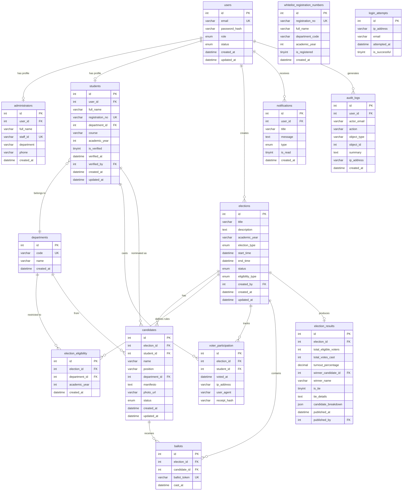

# ER Diagram — College Voting System

## Privacy-Enhanced Ballot Design

The schema separates voter identity from ballot choices:

- **`voter_participation`** records *who* voted in *which* election (unique constraint enforces one vote per student per election)
- **`ballots`** records *which candidate* received a vote — with **no student_id foreign key**

There is no direct join between a specific student and their candidate choice. An opaque `ballot_token` links the ballot record to no particular voter.

> ⚠️ **Limitation:** Even without a direct link, correlation through timestamps, sequential IDs, or application logs may still reveal voter choices. True ballot secrecy requires reviewed cryptographic design.

---

## Mermaid ER Diagram



---

## Relationship Summary

| Relationship | Type | Notes |
|---|---|---|
| users → administrators | 1:0..1 | Admin profile (optional) |
| users → students | 1:0..1 | Student profile (optional) |
| students → voter_participation | 1:many | One participation per election |
| elections → voter_participation | 1:many | UNIQUE(election_id, student_id) |
| elections → ballots | 1:many | No student FK — privacy model |
| candidates → ballots | 1:many | How candidate votes are counted |
| elections → election_results | 1:0..1 | Frozen on publication |

---

## Key Constraints

```sql
-- One vote per student per election
UNIQUE KEY uq_election_student (election_id, student_id)  -- voter_participation

-- Unique anonymous ballot token
UNIQUE KEY (ballot_token)  -- ballots

-- One published result per election  
UNIQUE KEY (election_id)  -- election_results

-- Unique user email
UNIQUE KEY (email)  -- users

-- Unique student registration number
UNIQUE KEY (registration_no)  -- students
```
